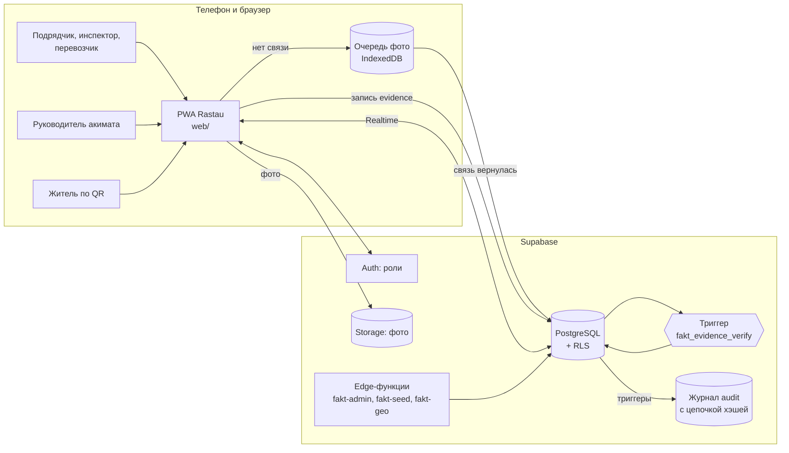
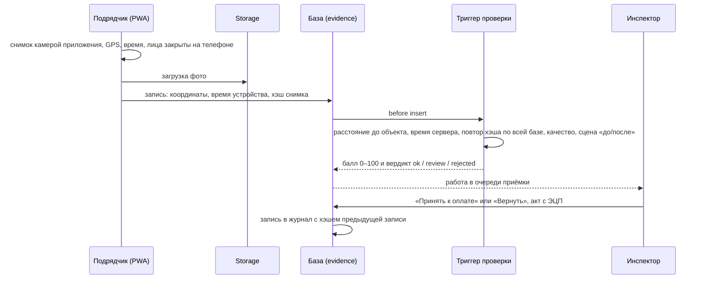

# Архитектура Rastau

Rastau состоит из трёх частей: веб-приложения (PWA) для всех ролей, серверной базы Supabase, где проверяется каждое фото, и статической страницы с материалами проекта.



## Как проверяется фото

Решение о балле доверия принимает сервер, а не телефон. Телефон показывает только предварительную проверку.



Балл начинается со 100 и снижается за каждое нарушение: снято не камерой приложения, слабый GPS, далеко от точки работ, расхождение времени, повтор снимка, плохое качество, «после» совпадает с «до». От 80 баллов фото подтверждено, от 50 уходит инспектору на проверку, ниже 50 отклонено.

## Данные

| Таблица | Что хранит |
|---|---|
| `objects` | стройки, участки дорог, контейнерные площадки с координатами |
| `contractors` | подрядчики и их индекс надёжности |
| `orders` | заявки на устранение дефектов и сроки |
| `evidence` | фото-доказательства, балл и вердикт сервера |
| `tracks` | GPS-треки объездов инспекторов |
| `reports` | обращения жителей по QR |
| `audit` | журнал действий: каждая запись хранит хэш предыдущей, изменять её нельзя |
| `profiles`, `settings` | пользователи с ролями, нормативы |

Доступ ограничен политиками RLS по ролям: подрядчик видит только свои объекты, житель получает только публичную карточку объекта через функцию `fakt_public_object`.

## Режимы работы приложения

- **Онлайн**: `web/src/api/supabase.js`, данные в Supabase, обновления через Realtime.
- **Офлайн-демо**: `web/src/api/local.js`, та же логика (`web/src/api/logic.js`) на демо-данных в браузере. Включается на `127.0.0.1` или по `?offline`.
- **Без связи в поле**: `web/src/lib/outbox.js` держит фото в очереди и отправляет их, когда появляется сеть. Сервер видит задержку отправки.

## Структура репозитория

```
web/                 приложение (PWA, без сборщика)
  index.html, sw.js  оболочка и service worker
  src/ui/            экраны: аким, инспектор, подрядчик, житель, план пилота
  src/api/           онлайн и офлайн режимы с общей логикой
  src/lib/           проверки фото, очередь без связи, приватность, ЭЦП (NCALayer), импорт Excel
  scripts/build.mjs  сборка в dist/ для хостинга
supabase/            схема БД, миграции, edge-функции
docs/                скриншоты, слайды, страница проекта, описание для YouTube
```

## Безопасность и закон РК

- ИИ и проверки сервера только советуют. Оплату принимает человек.
- Лица и номера машин закрываются на телефоне до отправки (MediaPipe на устройстве).
- Акты подписываются ЭЦП через NCALayer. В пилоте вход по ЭЦП и eGov.
- В пилоте данные хранятся в Казахстане: сервер акимата или казахстанское облако.
- В журнал можно писать только из триггеров базы. Подделка задним числом ломает цепочку хэшей, и проверка показывает номер записи.
- Секреты не хранятся в коде: ключи edge-функций берутся из переменных окружения (`SUPABASE_SERVICE_ROLE_KEY`, `GEO_KEY`).
