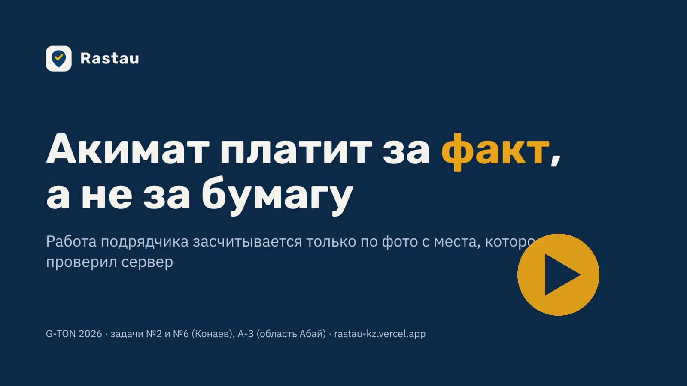
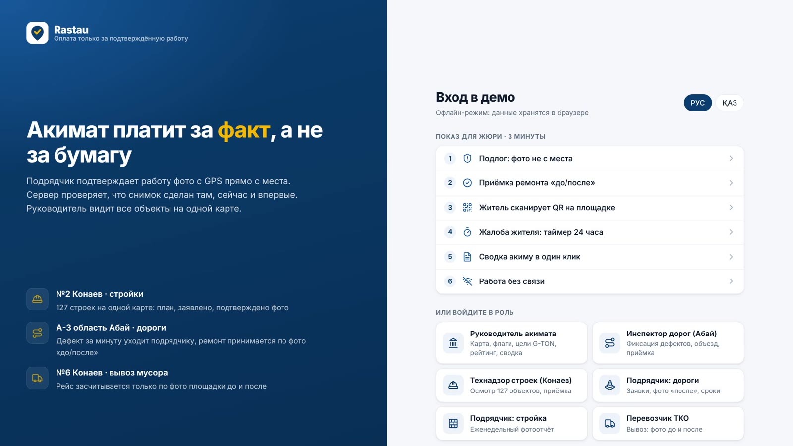
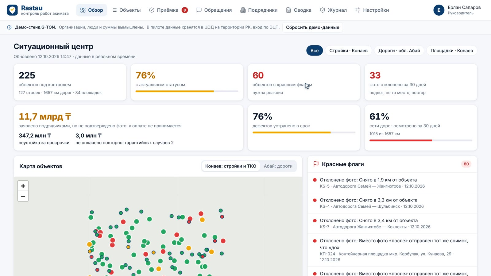
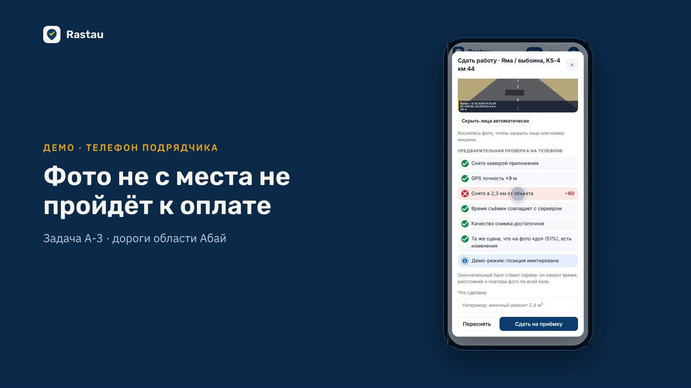
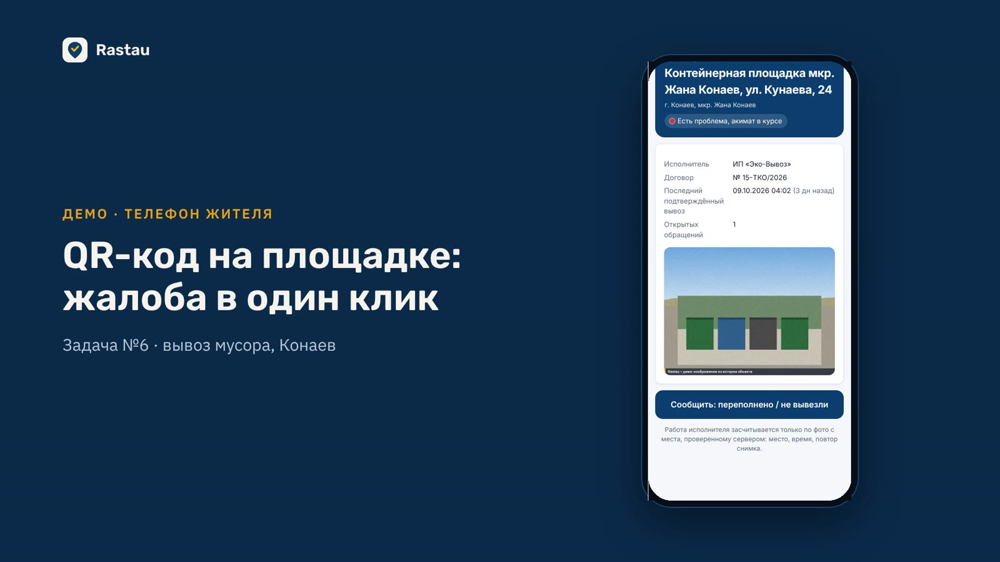
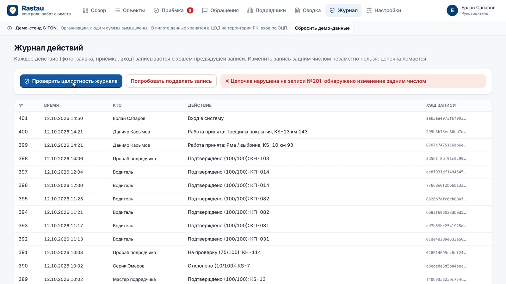

<p align="center">
  
</p>

<h1 align="center">Rastau</h1>

<p align="center"><b>Акимат платит за факт, а не за бумагу.</b><br>
Работа подрядчика засчитывается только по фото с места, которое проверил сервер.</p>

<p align="center">
  <a href="https://rastau-kz.vercel.app"><b>Демо-стенд</b></a> ·
  <a href="https://facei7505-droid.github.io/rastau.kz/"><b>Видео и презентация</b></a> ·
  <a href="docs/presentation/rastau-presentation.pdf">Презентация PDF</a> ·
  <a href="docs/TECH.md">Техническое описание</a>
</p>

<p align="center">
  <a href="https://facei7505-droid.github.io/rastau.kz/"></a><br>
  <sub>▶ Видео 5:27 с озвучкой: презентация и показ живой системы. <a href="docs/video/rastau-video.mp4">Скачать MP4</a> · <a href="docs/video/rastau-video-subtitles.mp4">с субтитрами</a></sub>
</p>

---

## Зачем

Сегодня акимат узнаёт о ходе работ звонком, фото в WhatsApp и актом, который пишет сам подрядчик. Ни одно из этого не подтверждено: фото можно снять где угодно, объём в акте можно завысить. Rastau превращает «мне сказали» в проверенный факт с координатами, временем и историей.

Проект сделан для акселератора **G-TON 2026** (Smart City Kazakhstan) и закрывает три задачи акиматов:

| Задача | Регион | Что делает Rastau |
|---|---|---|
| **№2** Единая карта инфраструктурных объектов | Конаев | 127 строек на одной карте: план, заявлено подрядчиком, подтверждено фото |
| **А-3** Дороги области | область Абай | Дефект за минуту уходит подрядчику, ремонт принимается по фото «до/после», гарантия 12 месяцев |
| **№6** Мониторинг мусорных площадок | Конаев | Вывоз засчитывается только по фото площадки до и после, житель жалуется по QR |

## Как это работает

1. **Снимок на месте.** Камера приложения, без загрузки из галереи. GPS и время пишутся сами.
2. **Проверка сервером.** Расстояние до объекта, время съёмки, повтор снимка по всей базе, сходство «до/после».
3. **Решение человека.** Инспектор принимает или возвращает работу, акт подписывается ЭЦП (NCALayer).
4. **Оплата и история.** Акимат платит только за подтверждённое, у подрядчика копится рейтинг надёжности.

Каждое действие пишется в журнал с цепочкой хэшей: подделку задним числом видно сразу.

## Скриншоты

| Вход для жюри и ролей | Ситуационный центр акима |
|---|---|
|  |  |
| **Подрядчик: фото не с места отклонено** | **Инспектор: приёмка «до/после»** |
|  |  |
| **Житель: QR на площадке** | **Журнал с цепочкой хэшей** |
|  |  |

## Попробовать

Откройте **[rastau-kz.vercel.app](https://rastau-kz.vercel.app)** и выберите сценарий для жюри или роль. Пароль для всех демо-ролей: `fakt2026`. Организации, люди и суммы в демо вымышлены.

## Закон и доверие

- ИИ только советует, решение об оплате принимает человек.
- Лица и номера машин закрываются на телефоне до отправки.
- Акты подписываются ЭЦП через NCALayer, вход в пилоте по ЭЦП и eGov.
- В пилоте данные хранятся в Казахстане: сервер акимата или казахстанское облако.
- Без связи фото ждёт в очереди на телефоне и уходит само.
- Интерфейс на казахском и русском.

## Стек

PWA без сборки: Preact + htm + Leaflet, ES-модули из `src/`. Бэкенд Supabase (PostgreSQL, Auth, Storage, Realtime): баллы доверия считает триггер на сервере. Распознавание лиц на устройстве через MediaPipe. Хостинг Vercel.

```bash
npm install
python3 -m http.server 5175   # открыть http://127.0.0.1:5175
```

На `127.0.0.1` приложение работает офлайн с демо-данными в браузере. Подробности в [docs/TECH.md](docs/TECH.md).

## Структура

```
index.html, sw.js, manifest.json   оболочка PWA
src/ui/        экраны: аким, инспектор, подрядчик, житель, план пилота
src/api/       онлайн (Supabase) и офлайн (IndexedDB) режимы
src/lib/       проверки фото, очередь без связи, приватность, ЭЦП
supabase/      схема БД, миграции, edge-функции
docs/          видео, презентация, скриншоты, страница для GitHub Pages
```

## Пилот

8 недель до Demo Day. От акимата: куратор на 1 час в неделю, списки объектов в Excel, 5–10 инспекторов с обычными телефонами. ПО, обучение и QR-таблички на время пилота бесплатно. План: [rastau-kz.vercel.app/#/pilot](https://rastau-kz.vercel.app/#/pilot).
